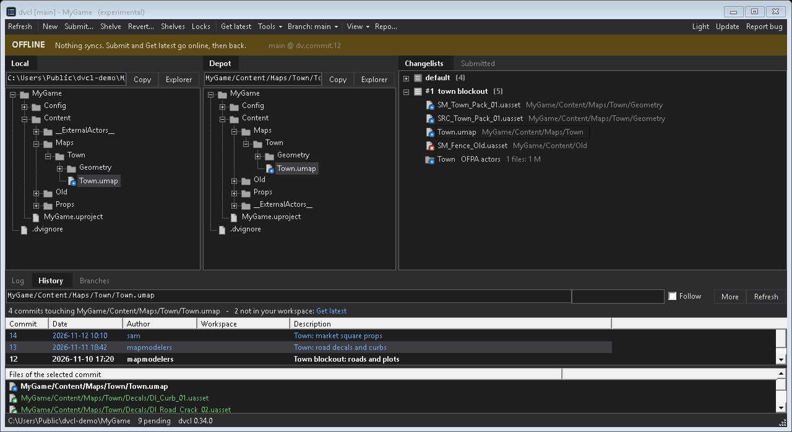

# dvcl

Changelists for [Diversion](https://diversion.dev). [Site](https://mapmodelers.github.io/dvcl/)

**Experimental:** used daily on a real Unreal project, still changing. Feedback and ideas welcome: [open an issue](https://github.com/mapmodelers/dvcl/issues).

- Numbered changelists: group pending files, submit, shelve, revert.
- Shelves belong to their changelist, files always listed; unshelve into any changelist (menu or drag), all or selected files.
- Unreal OFPA actor files: one line per level instead of thousands of rows (View menu).
- Stay offline (default): sync is on only during an action, never left on, even if dvcl is killed mid-way.
- Local and Depot trees, state icons, path bars. Drop a file on a tree to find it.
- Submitted and History: commits, their files, what you have not got yet.
- Unreal: revert, unshelve and get latest without restarting the editor (dvcl link plugin: Tools > Unreal link, install once).
- Branches: list, create, switch safely (pending work is never carried over by accident), merge; changelists remember their branch.
- Unreal revision control "dvcl": file states in the Content Browser, dvcl changelists in Unreal's Changelists window, Revert and Submit from Unreal, offline, no login (pick dvcl in Revision Control > Connect).
- Panels you arrange: drag tabs together, to an edge, or out into their own window.
- Command line: `dvcl help`.

## Install

1. Windows 10 / 11 with [Diversion Desktop](https://diversion.dev) installed and signed in, your workspace synced (the `dv` command works in a terminal).
2. [Download](https://github.com/mapmodelers/dvcl/archive/refs/heads/main.zip), unzip anywhere (not inside your workspace), run `install.cmd`: desktop and Start menu shortcuts, then dvcl opens.
3. First run: pick your Diversion workspace (dvcl lists the ones it finds, or Browse). It is remembered; Repo... changes it.
4. Optional, Unreal: Tools > Unreal link > Install (needs Visual Studio and Python 3; in Unreal, Python Editor Script plugin with Remote Execution on).

Uninstall: `uninstall.cmd` (closes dvcl, removes the shortcuts and dvcl.exe, asks about your settings; remove the Unreal link first in Tools > Unreal link > Remove).

Settings are per Windows user (`%APPDATA%\dvcl`); each workspace keeps its changelists in its own `.dvcl` folder. Update: toolbar Update.

No telemetry: GitHub is contacted only by Update and Report bug. Report bug writes `dvcl-bug-report.txt` on your desktop (dvcl's own log lines; your folders, user name, PC name, e-mail and Diversion ids replaced) and opens a GitHub issue to attach it; review it first.

MIT, as is. Not affiliated with or endorsed by Diversion; Diversion is a trademark of its owner.
