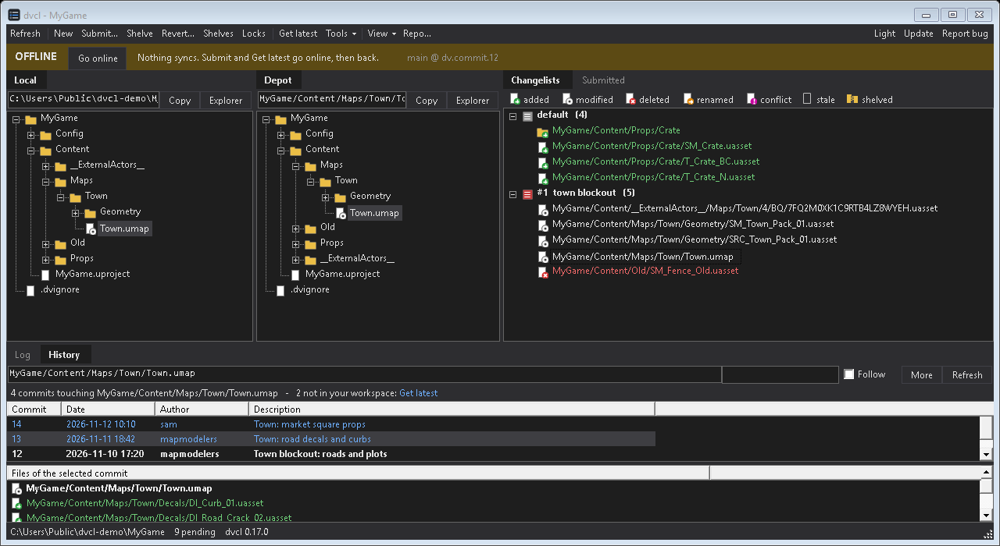

# dvcl

Changelists for [Diversion](https://diversion.dev).

Download, run `install.cmd`. Requires Windows and the Diversion `dv` CLI.

**Update** and **Report bug** are in the window. Command line: `dvcl help`.

No telemetry: dvcl contacts GitHub only when you click Update or Report bug.

MIT license, provided as is. Not affiliated with or endorsed by Diversion; Diversion is a trademark of its owner.
